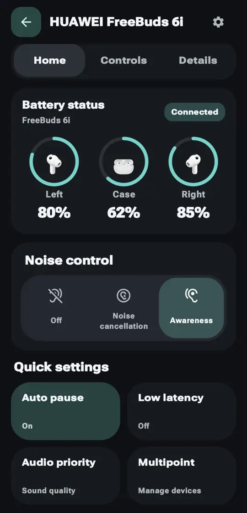

<div align="center">


# LibreBuds+

### Your Huawei earbuds. Your controls. Your Android.

**A Huawei-focused community fork of LibreBuds** with expanded model recognition,
model-aware controls and a refined companion-app experience.

<a href="https://github.com/vnxrgb/librebudsplus/releases/latest"></a>
<a href="https://github.com/vnxrgb/librebudsplus/releases"></a>
<a href="https://github.com/vnxrgb/librebudsplus/releases/tag/v1.2.0"></a>
<a href="LICENSE"></a>


<br />

**[Download stable APK](https://github.com/vnxrgb/librebudsplus/releases/latest)** ·
**[Huawei device support](#huawei-device-support)** ·
**[What's different](#built-for-huawei-shaped-by-this-fork)** ·
**[Build it](#build-from-source)**

</div>

<p align="center">
  
  
  
  
</p>
<p align="center">
  
  
  
  
</p>

## Features at a glance

LibreBuds+ offers these features **on Huawei models that support them**:

| Everyday controls | Device-specific extras | Android integration |
| --- | --- | --- |
| Left / right / case battery levels when reported | ANC, Awareness and noise-control levels | Battery notification and Quick Settings tile |
| EQ presets and custom 10-band equalizer | Tap, pinch, swipe and head gestures | Case-open popup and connection island |
| Find earbuds sound | Multipoint, wear detection, low latency, HD calls and sound options | Home-screen widgets and Material You appearance |

The available controls are selected from the connected Huawei model profile and its reported capabilities. Unsupported or unverified features are not promised to work on every model.

## Built for Huawei. Shaped by this fork.

LibreBuds+ stays focused on Huawei audio hardware rather than promising controls for unrelated earbuds. It uses model profiles and the features each device reports to decide which settings appear.

| What sets LibreBuds+ apart | What it means |
| --- | --- |
| **FreeBuds 6i is the reference device** | Battery and core controls were confirmed by the maintainer on physical FreeBuds 6i hardware. |
| **40 Huawei audio profiles** | Better identification across FreeBuds, FreeClip, FreeArc, FreeLace, Eyewear and W Buds; models beyond the tested set still need device testing. |
| **Model-aware settings** | ANC, Awareness, EQ, gesture controls and other actions depend on the earbud's profile and actual capabilities. |
| **Call-aware background connection** | Vendor-control traffic pauses during calls to coexist with Android's Bluetooth audio handling; this isn't a guaranteed microphone fix. |
| **Smarter artwork fallback** | Close variants can share family art; unusual devices avoid misleading case pictures. |
| **Two independent installation channels** | Signed stable keeps `io.github.librebuds`, while `io.github.librebuds.alpha` can be installed for testing. |

> **Compatibility note:** A recognized device profile does not mean its hardware was tested. Features and control commands can vary with the model and firmware. See the [Huawei compatibility matrix](docs/HUAWEI_MODEL_MATRIX.md).

## Huawei device support

These are **Huawei audio-device profiles supported by the app**, not a claim that every feature works on every model.

| Huawei model | Verification | Available support | Artwork |
| --- | --- | --- | --- |
| **FreeBuds 6i** | ✅ **Owner-tested with real earbuds** | Battery, ANC/Awareness, equalizer, gestures and existing compatible settings; microphone voice note was checked | Existing Pro 5-style illustration (approximate) |
| **FreeBuds 5** | ✅ **Tested in original LibreBuds** | Original model-specific controls; not retested in this fork | Model illustration |
| **FreeBuds Pro 5** | ✅ **Tested in original LibreBuds** | Original model-specific controls; not retested in this fork | Model illustration |
| FreeBuds 3, 4, 6; Pro 2, Pro 3, Pro 4 | 🟡 **Needs hardware testing in this fork** | Existing model profiles; battery, noise modes and other controls depend on firmware | Dedicated model illustrations |
| FreeBuds 4E / 4E v2; Pro 2+ | 🟡 **Needs testing** | Huawei protocol profiles with model-specific feature gating | Close-family illustration (approximate) |

<details>
<summary><b>Explore the other Huawei profiles (hardware tests welcome)</b></summary>

| Family | Profiled models |
| --- | --- |
| FreeBuds and i-series | 3i, 4i, 5i, 7, 7i, Pro, Lite, Neo, Studio |
| FreeBuds SE | SE, SE 2, SE 3, SE 4 ANC, SE 5 Max |
| FreeBuds Lipstick | Lipstick, Lipstick 2 |
| FreeClip / FreeArc | FreeClip, FreeClip 2 (and variant profile), FreeArc |
| FreeLace | FreeLace, Lite, Pro, Pro 2 |
| Other Huawei audio | W Buds, W Buds 2, Eyewear, Eyewear 2 |

These profiles offer **model recognition and best-effort Huawei protocol support**. Battery-only or partial operation is possible; **ANC, gestures, EQ and case battery are not confirmed** on these devices. They are not marked as fully working until tested on the actual hardware.

</details>

✅ = owner-tested or previously hardware-tested by the original project (as labelled). 🟡 = profiled but still requires real-device validation. Some illustrations are approximations; for unusual form factors, the UI avoids showing a fake charging case.

See the [full compatibility details](docs/DEVICE_COMPATIBILITY.md) and the [Huawei model and artwork matrix](docs/HUAWEI_MODEL_MATRIX.md). To report successful or unsuccessful hardware testing, please [open an issue](https://github.com/vnxrgb/librebudsplus/issues).

## Get LibreBuds+

**Stable:** [Download the latest signed APK](https://github.com/vnxrgb/librebudsplus/releases/latest) · **Alpha:** [Browse test builds](https://github.com/vnxrgb/librebudsplus/releases)

1. Download the signed stable `librebuds-plus-v1.2.0.apk` from [GitHub Releases](https://github.com/vnxrgb/librebudsplus/releases/latest).
   Release APKs are signed, so later versions install over earlier ones.
2. Open the APK on your phone and allow installs from your browser or file manager when asked.
3. Start LibreBuds+ and grant the permissions on the welcome screen.

Requires Android 13 or newer. LibreBuds+ is not on Google Play yet. Stable v1.2.0 upgrades stable v1.1.0 with the same package ID and signing certificate; alpha builds install separately.

<details>
<summary><b>"Display over other apps" is greyed out or blocked</b></summary>

<br />

Android treats this permission as a *restricted setting* for apps installed from a file. Open
**App info** for LibreBuds+, tap the **⋮** menu, choose **Allow restricted settings**, then grant
the permission again.

</details>

## Privacy and permissions

| Permission | Why |
| --- | --- |
| **Nearby devices** (Bluetooth connect and scan) | Talk to your paired earbuds, and notice when their case opens nearby for the popup. Declared as never used for location. |
| **Notifications** | Battery status and the background connection notice. |
| **Display over other apps** | Draw the popup card and the island over other apps. Without it, the popup shows as a notification. |
| **Companion device** (optional) | "Reliable background start" lets Android start LibreBuds when your earbuds connect, even after the system stopped the app. Android asks you to confirm. |

LibreBuds+ has no internet permission. It does not collect or send any data. Fonts are loaded
through Android's downloadable fonts service.

## Troubleshooting LibreBuds+

<details>
<summary><b>The popup does not show when I open the case</b></summary>

<br />

- Check that **Popup when the case opens** is on in LibreBuds+ settings.
- Grant **Nearby devices** and **Display over other apps** (see above for the restricted setting).
- Bluetooth must be on, and the earbuds must already be paired with the phone.
- The popup appears once per opening. Close the case for a few seconds before trying again.
- Use **Show test popup** in settings to check the popup itself works.

</details>

<details>
<summary><b>The popup shows as a notification instead of a card</b></summary>

<br />

LibreBuds+ falls back to a notification when it is not allowed to draw over other apps. Grant
**Display over other apps** in App info.

</details>

<details>
<summary><b>LibreBuds+ stops updating in the background</b></summary>

<br />

Some Android phones stop background services aggressively. Open **App info → Battery** and choose
**Unrestricted**, and turn on **Reliable background start** in LibreBuds+ settings.

</details>

<details>
<summary><b>"Controlled by another device"</b></summary>

<br />

Another phone or computer is currently connected to the earbuds' control channel. Tap
**Take over** to control them from this phone.

</details>

<details>
<summary><b>A setting does not change or shows Experimental</b></summary>

<br />

*Experimental* means the setting is supported by the model but not yet confirmed with real
earbuds. If it does not work, please open an issue with a diagnostics export.

</details>

## Build from source

You need JDK 17 or newer and the Android SDK (compile SDK 37). No keystore is needed for debug
builds.

```bash
git clone https://github.com/vnxrgb/librebudsplus.git
cd librebudsplus/android
./gradlew :app:assembleDebug        # app/build/outputs/apk/debug/app-debug.apk
./gradlew test                      # unit tests
```

Release builds are signed only when `android/keystore.properties` (or the path in
`LIBREBUDS_KEYSTORE_PROPERTIES`) is present; otherwise `./gradlew :app:assembleRelease`
produces an unsigned APK.

Debug builds have a demo mode in settings that shows sample earbuds, useful for UI work without
hardware.

## Contributing

Bug reports, Huawei-model test results and pull requests are welcome. Please distinguish actual device tests from simulations.

- When reporting a problem, attach a diagnostics export: **Settings → Share diagnostics** or
  **Save diagnostics to file**. The export leaves out serial numbers, host device names and full
  Bluetooth addresses.
- Mention your earbud model, firmware version (shown on the device screen) and phone.
- Before a pull request, run `./gradlew test` in `android/` and `python3 tools/check_ui_import.py`.

## Built on open-source work

- **[LibreBuds (original)](https://github.com/librebuds/librebuds)**: upstream project on which this fork is based; upstream authors and contributors retain credit.
- **[QuickBuds](https://github.com/spizganed/QuickBuds)**: inspiration for the interface's battery rings and segmented controls.
- [LibrePods](https://github.com/librepods-org/librepods) (GPL-3.0): LibreBuds started as a
  remake of the LibrePods Android app. Its UI components, theme, island and popup window are
  imported and modified. No LibrePods media or fonts are included.
- [OpenFreebuds](https://github.com/melianmiko/OpenFreebuds): the base of
  [LibreBuds for Windows](https://github.com/librebuds/librebuds-windows).
- Material Symbols icons by Google (Apache License 2.0) and the Inter typeface (SIL Open Font
  License 1.1).

See [NOTICE](NOTICE) for details.

## License

LibreBuds+ is free software, licensed under the [GNU General Public License v3.0](LICENSE).

## Disclaimer

LibreBuds+ is an independent project. It is not affiliated with or endorsed by Huawei.
FreeBuds and HUAWEI are trademarks of Huawei Technologies Co., Ltd. Product names are used only
to identify compatible devices.
