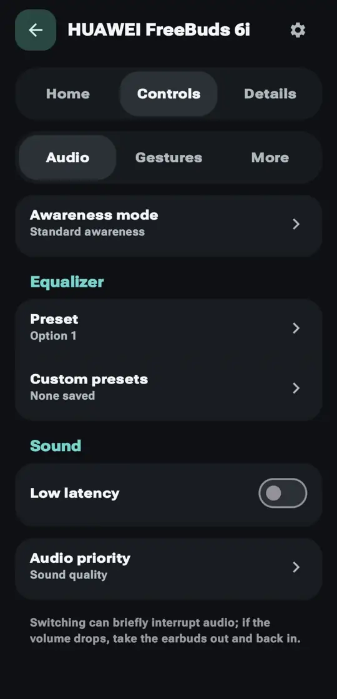
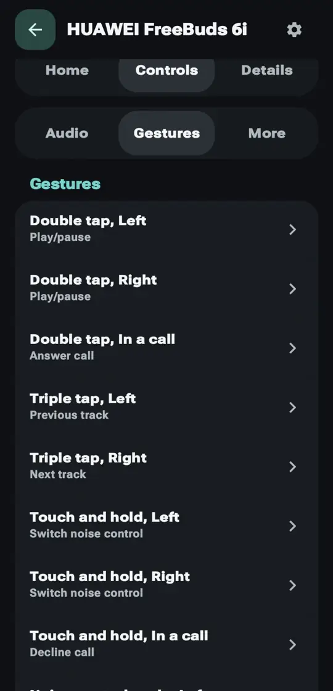
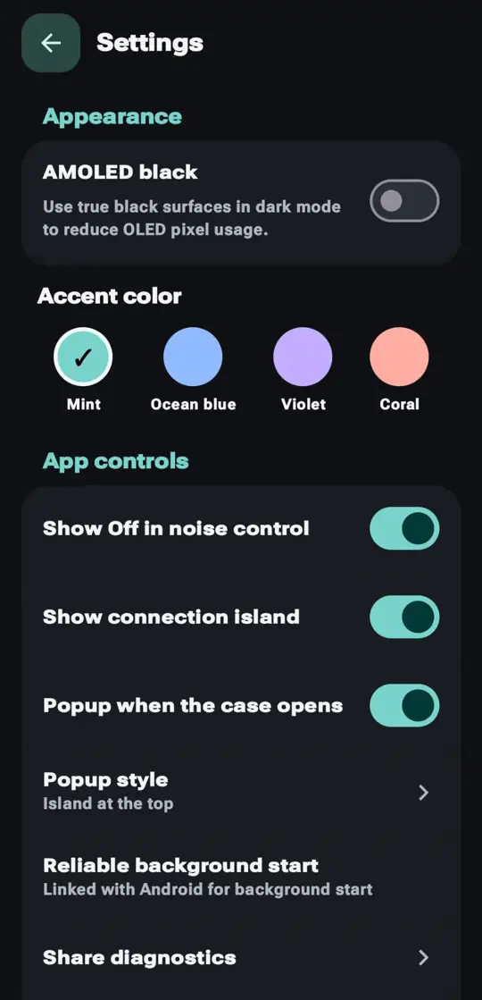

<div align="center">


# LibreBuds+

**Open-source companion app for HUAWEI FreeBuds and related Huawei audio devices on Android.**<br />
Battery, noise control, gestures, equalizer and a popup when you open the case. No root, no vendor app.

<a href="https://github.com/vnxrgb/librebudsplus/releases"></a>
<a href="https://github.com/vnxrgb/librebudsplus/releases"></a>
<a href="LICENSE"></a>


<a href="https://github.com/librebuds/librebuds-windows"></a>

<br />

<a href="https://github.com/vnxrgb/librebudsplus/releases"><b>Download</b></a> ·
<a href="#features">Features</a> ·
<a href="#supported-models">Supported models</a> ·
<a href="#faq-and-troubleshooting">FAQ</a> ·
<a href="#building-from-source">Build</a>

</div>

<br />

<p align="center">
  
  
  
  
</p>
<p align="center">
  
  
  
  
</p>

> [!NOTE]
> **Stable v1.2.0 is Huawei-only.** FreeBuds 6i functionality was confirmed by the maintainer on real hardware. The 40 Huawei audio model profiles are **not all hardware-tested**; features vary by model and firmware. Bug reports with diagnostics are very welcome.

## Features

| Feature | Details |
| --- | --- |
| **Popup when the case opens** | A card that slides up with an animation of your model's case opening, or a compact island at the top of the screen. Shows left, right and case battery. |
| **Battery** | Separate levels for the left earbud, right earbud and case, with charging state. Also in a persistent notification, a home screen widget and the quick settings tile. |
| **Noise control** | Off, noise cancellation and awareness, with the levels your model offers (for example Dynamic, Cozy, General, Ultra or Dual-engine). |
| **Awareness modes** | Standard, voice mode and adaptive awareness, plus the awareness level where supported. |
| **Gestures** | Double tap, triple tap, touch and hold, swipe and the noise control cycle, per earbud and during calls. Pinch controls on stem models. Head gestures (nod, shake) to answer or decline calls. |
| **Equalizer** | Built-in presets and up to three custom presets with a 10-band editor. |
| **Find earbuds** | Play a sound on the left or right earbud. |
| **Sound** | Low latency mode, sound quality priority, pickup mode and voice prompt language. |
| **Multipoint** | Turn dual connection on or off, see the connected devices, pick the preferred one, connect or disconnect them. |
| **More settings** | Wear detection, single-earbud noise cancelling, adaptive volume, conversation awareness, ear tip type, drop detection, rest reminders and HD calls, depending on the model. |
| **Quick settings tile** | Battery at a glance and noise control from the notification shade. |
| **Widgets** | A battery widget and a noise control widget. |
| **Connection island** | A small island when the earbuds connect or move to another device, with an undo action. |
| **Material You** | Optional dynamic colours, light and dark theme. |

Which settings appear depends on what your earbuds report. Settings that have not yet been
confirmed on a given model are labelled *Experimental* in the app.

## What's new in LibreBuds+ v1.2.0

This fork builds on the original LibreBuds interface and Huawei control stack, with these additions and refinements:

- **FreeBuds 6i improvements:** maintained the existing battery, ANC/Awareness, equalizer and gesture controls, with owner-confirmed functionality on real FreeBuds 6i; adjusted the case illustration alignment.
- **Broader Huawei recognition:** 40 Huawei audio profiles covering additional FreeBuds, FreeClip, FreeArc, FreeLace, Eyewear and W Buds variants; improved model-name matching (case, spaces, optional HUAWEI prefix and factory suffix), with no promise of untested protocol commands.
- **Call coexistence:** pauses the app's proprietary control traffic while Android handles a phone/VoIP call. This is a precaution, **not** a WhatsApp microphone-gain or codec modification and not a guaranteed microphone fix.
- **Artwork refinements:** model-specific illustrations where available, close-family art for some variants and safer text-only battery slots for designs without accurate earbud/case art.
- **Separate alpha channel:** test builds install alongside stable; the signed stable APK retains the established application ID and upgrade signing key.

For the full history, see [CHANGELOG.md](CHANGELOG.md). For evidence by model and artwork limitations, see [the Huawei model matrix](docs/HUAWEI_MODEL_MATRIX.md).

## Supported models

These are **Huawei audio-device profiles supported by the app**, not a claim that every feature works on every model.

| Huawei model | Verification | Available support | Artwork |
| --- | --- | --- | --- |
| **FreeBuds 6i** | ✅ **Owner-tested with real earbuds** | Battery, ANC/Awareness, equalizer, gestures and existing compatible settings; microphone voice note was checked | Existing Pro 5-style illustration (approximate) |
| **FreeBuds 5** | ✅ **Tested in original LibreBuds** | Original model-specific controls; not retested in this fork | Model illustration |
| **FreeBuds Pro 5** | ✅ **Tested in original LibreBuds** | Original model-specific controls; not retested in this fork | Model illustration |
| FreeBuds 3, 4, 6; Pro 2, Pro 3, Pro 4 | 🟡 **Needs hardware testing in this fork** | Existing model profiles; battery, noise modes and other controls depend on firmware | Dedicated model illustrations |
| FreeBuds 4E / 4E v2; Pro 2+ | 🟡 **Needs testing** | Huawei protocol profiles with model-specific feature gating | Close-family illustration (approximate) |

<details>
<summary><b>More Huawei devices with profiles — need testing</b></summary>

| Family | Profiled models |
| --- | --- |
| FreeBuds and i-series | 3i, 4i, 5i, 7, 7i, Pro, Lite, Neo, Studio |
| FreeBuds SE | SE, SE 2, SE 3, SE 4 ANC, SE 5 Max |
| FreeBuds Lipstick | Lipstick, Lipstick 2 |
| FreeClip / FreeArc | FreeClip, FreeClip 2 (and variant profile), FreeArc |
| FreeLace | FreeLace, Lite, Pro, Pro 2 |
| Other Huawei audio | W Buds, W Buds 2, Eyewear, Eyewear 2 |

These profiles offer **model recognition and best-effort Huawei protocol support**. Battery-only or partial operation is possible; **ANC, gestures, EQ and case battery are not confirmed** on these devices. They are not marked as fully working until tested on the actual hardware.

</details>

✅ = owner-tested or previously hardware-tested by the original project (as labelled). 🟡 = profiled but still requires real-device validation. Some illustrations are approximations; for unusual form factors, the UI avoids showing a fake charging case.

See the [full compatibility details](docs/DEVICE_COMPATIBILITY.md) and the [Huawei model and artwork matrix](docs/HUAWEI_MODEL_MATRIX.md). To report successful or unsuccessful hardware testing, please [open an issue](https://github.com/vnxrgb/librebudsplus/issues).

## Download and install

1. Download the signed stable `librebuds-plus-v1.2.0.apk` from [GitHub Releases](https://github.com/vnxrgb/librebudsplus/releases/latest).
   Release APKs are signed, so later versions install over earlier ones.
2. Open the APK on your phone and allow installs from your browser or file manager when asked.
3. Start LibreBuds+ and grant the permissions on the welcome screen.

Requires Android 13 or newer. LibreBuds+ is not on Google Play yet. Stable v1.2.0 upgrades stable v1.1.0 with the same package ID and signing certificate; alpha builds install separately.

<details>
<summary><b>"Display over other apps" is greyed out or blocked</b></summary>

<br />

Android treats this permission as a *restricted setting* for apps installed from a file. Open
**App info** for LibreBuds+, tap the **⋮** menu, choose **Allow restricted settings**, then grant
the permission again.

</details>

## Permissions

| Permission | Why |
| --- | --- |
| **Nearby devices** (Bluetooth connect and scan) | Talk to your paired earbuds, and notice when their case opens nearby for the popup. Declared as never used for location. |
| **Notifications** | Battery status and the background connection notice. |
| **Display over other apps** | Draw the popup card and the island over other apps. Without it, the popup shows as a notification. |
| **Companion device** (optional) | "Reliable background start" lets Android start LibreBuds when your earbuds connect, even after the system stopped the app. Android asks you to confirm. |

LibreBuds+ has no internet permission. It does not collect or send any data. Fonts are loaded
through Android's downloadable fonts service.

## Windows

The Windows app lives in a separate repository: [librebuds/librebuds-windows](https://github.com/librebuds/librebuds-windows),
a fork of [OpenFreebuds](https://github.com/melianmiko/OpenFreebuds).

## FAQ and troubleshooting

<details>
<summary><b>The popup does not show when I open the case</b></summary>

<br />

- Check that **Popup when the case opens** is on in LibreBuds+ settings.
- Grant **Nearby devices** and **Display over other apps** (see above for the restricted setting).
- Bluetooth must be on, and the earbuds must already be paired with the phone.
- The popup appears once per opening. Close the case for a few seconds before trying again.
- Use **Show test popup** in settings to check the popup itself works.

</details>

<details>
<summary><b>The popup shows as a notification instead of a card</b></summary>

<br />

LibreBuds+ falls back to a notification when it is not allowed to draw over other apps. Grant
**Display over other apps** in App info.

</details>

<details>
<summary><b>LibreBuds+ stops updating in the background</b></summary>

<br />

Some phones stop background apps aggressively. Open **App info → Battery** and choose
**Unrestricted**, and turn on **Reliable background start** in LibreBuds+ settings.

</details>

<details>
<summary><b>"Controlled by another device"</b></summary>

<br />

Another phone or computer is currently connected to the earbuds' control channel. Tap
**Take over** to control them from this phone.

</details>

<details>
<summary><b>A setting does not change or shows Experimental</b></summary>

<br />

*Experimental* means the setting is supported by the model but not yet confirmed with real
earbuds. If it does not work, please open an issue with a diagnostics export.

</details>

## Building from source

You need JDK 17 or newer and the Android SDK (compile SDK 37). No keystore is needed for debug
builds.

```bash
git clone https://github.com/vnxrgb/librebudsplus.git
cd librebudsplus/android
./gradlew :app:assembleDebug        # app/build/outputs/apk/debug/app-debug.apk
./gradlew test                      # unit tests
```

Release builds are signed only when `android/keystore.properties` (or the path in
`LIBREBUDS_KEYSTORE_PROPERTIES`) is present; otherwise `./gradlew :app:assembleRelease`
produces an unsigned APK.

Debug builds have a demo mode in settings that shows sample earbuds, useful for UI work without
hardware.

## Contributing

Bug reports, Huawei-model test results and pull requests are welcome. Please distinguish actual device tests from simulations.

- When reporting a problem, attach a diagnostics export: **Settings → Share diagnostics** or
  **Save diagnostics to file**. The export leaves out serial numbers, host device names and full
  Bluetooth addresses.
- Mention your earbud model, firmware version (shown on the device screen) and phone.
- Before a pull request, run `./gradlew test` in `android/` and `python3 tools/check_ui_import.py`.

## Credits

- **[LibreBuds (original)](https://github.com/librebuds/librebuds)**: upstream project on which this fork is based; upstream authors and contributors retain credit.
- **[QuickBuds](https://github.com/spizganed/QuickBuds)**: inspiration for the interface's battery rings and segmented controls.
- [LibrePods](https://github.com/librepods-org/librepods) (GPL-3.0): LibreBuds started as a
  remake of the LibrePods Android app. Its UI components, theme, island and popup window are
  imported and modified. No LibrePods media or fonts are included.
- [OpenFreebuds](https://github.com/melianmiko/OpenFreebuds): the base of
  [LibreBuds for Windows](https://github.com/librebuds/librebuds-windows).
- Material Symbols icons by Google (Apache License 2.0) and the Inter typeface (SIL Open Font
  License 1.1).

See [NOTICE](NOTICE) for details.

## License

LibreBuds+ is free software, licensed under the [GNU General Public License v3.0](LICENSE).

## Disclaimer

LibreBuds+ is an independent project. It is not affiliated with or endorsed by Huawei.
FreeBuds and HUAWEI are trademarks of Huawei Technologies Co., Ltd. Product names are used only
to identify compatible devices.
