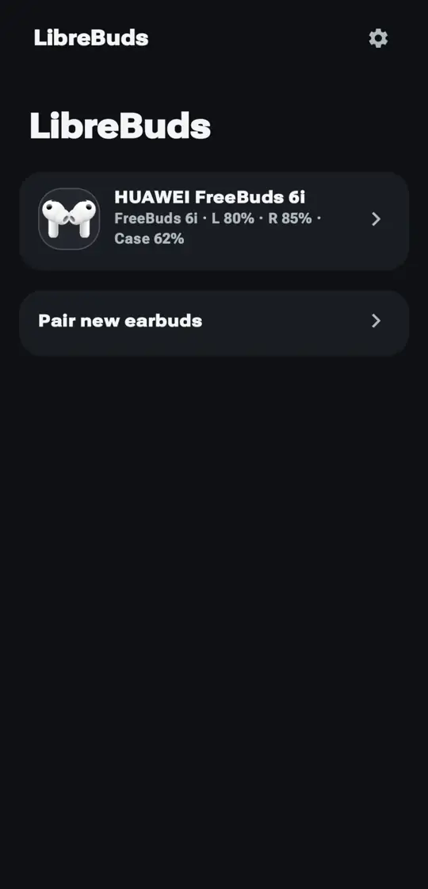
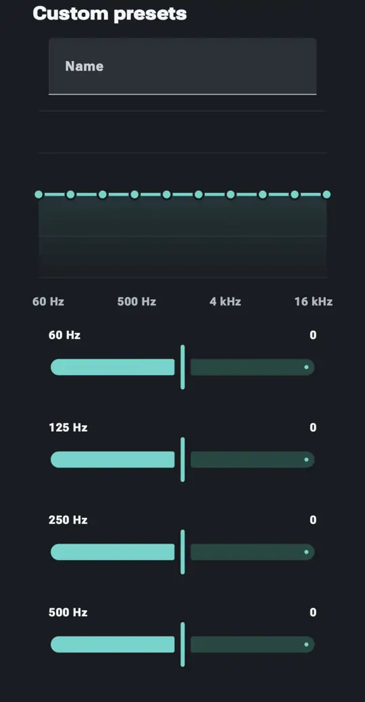
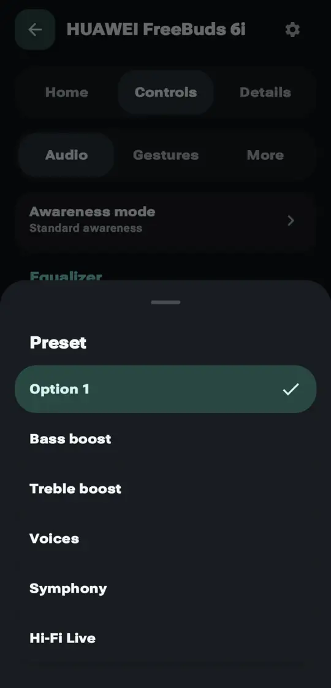
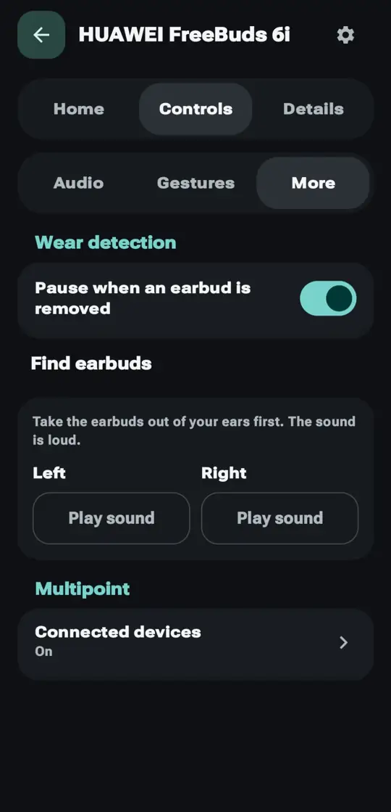

<div align="center">


# LibreBuds 6i

**An open-source Android companion for HUAWEI FreeBuds, with a FreeBuds 6i-focused fork.**<br />
A modern, QuickBuds-inspired interface for battery monitoring, noise control, sound settings, gestures and more. No root or Huawei AI Life required.

Built on [LibreBuds](https://github.com/librebuds/librebuds) · UI inspired by [QuickBuds](https://github.com/spizganed/QuickBuds) · Licensed under GPLv3.

<a href="https://github.com/vnxrgb/librebuds-6i/releases"></a>
<a href="https://github.com/vnxrgb/librebuds-6i/releases"></a>
<a href="LICENSE"></a>


<a href="https://github.com/librebuds/librebuds-windows"></a>

<br />

<a href="https://github.com/vnxrgb/librebuds-6i/releases"><b>Download this fork</b></a> ·
<a href="#features">Features</a> ·
<a href="#screenshots">Screenshots</a> ·
<a href="#supported-models">Supported models</a> ·
<a href="#faq-and-troubleshooting">FAQ</a> ·
<a href="#building-from-source">Build</a>

</div>

<br />

## Screenshots

The screenshots below show this fork running with **FreeBuds 6i** in its QuickBuds-inspired dark theme. The UI also supports AMOLED black and customizable accent colors.

<p align="center">
  
  
  
  
</p>
<p align="center">
  
  
  
  
</p>

<details>
<summary>Screenshot guide</summary>

| Screen | What it shows |
| --- | --- |
| Device list | Your paired FreeBuds 6i and quick battery summary |
| Home | Left / case / right battery rings, ANC / Awareness / Off, and rounded quick settings |
| Controls → Audio | Awareness mode, EQ presets, sound quality and low-latency controls |
| Custom equalizer | Animated EQ curve above the 10-band editor |
| EQ preset picker | Built-in EQ profiles with the selected setting highlighted |
| Controls → Gestures | Left/right tap and long-press assignments |
| Controls → More | Wear detection, Find Earbuds and multipoint access |
| Settings → Appearance | AMOLED black and Mint / Ocean blue / Violet / Coral accents |

</details>

> [!NOTE]
> This is a community fork built on LibreBuds and inspired by QuickBuds' design language. Some model-specific capabilities are still experimental. A successful APK build or a screenshot does **not** mean every feature has been verified with FreeBuds 6i hardware. Please include a diagnostics export when reporting an issue.

## Features

### QuickBuds-inspired interface

- **One consistent default design.** The former selectable Glass / Apple-style interface has been retired. New and existing installations use the QuickBuds-inspired Material / Compose UI.
- **Home / Controls / Details.** A focused product dashboard instead of one endlessly scrolling settings page; Controls is further organized into **Audio, Gestures, More**.
- **Compact battery overview.** Animated, equal-sized battery rings for the left earbud, charging case and right earbud, including charging / unavailable states.
- **Rounded ANC selector.** Equal-width Off / Noise cancellation / Awareness buttons with aligned icons and labels.
- **Everyday Quick Settings.** Auto pause, Low latency, **Audio priority** (opens a real sound-quality picker), and Multipoint (opens device management), shown according to device capabilities.
- **Appearance options.** Dark/light themes, **AMOLED black** surfaces and four persistent accent presets: **Mint, Ocean blue, Violet, Coral**.
- **Modern settings.** Consistent rounded cards, option sheets, compact status rows and dedicated left/right Find Earbuds actions.

### Earbud functionality

| Feature | Details |
| --- | --- |
| **Battery and charging** | Left / right / case battery levels, charging state, persistent notification, widget, and Android Quick Settings tile. |
| **Noise control** | Off, ANC and Awareness, with supported noise cancelling strengths and awareness / voice modes. |
| **Audio priority** | Choose sound quality or connectivity preference where available, directly from Quick Settings on the Home dashboard or the Audio page. |
| **Equalizer** | Built-in presets, custom preset management, a live EQ curve and 10-band custom editor. |
| **Gestures** | Per-earbud double / triple tap, touch-and-hold and model-supported call / playback gestures. |
| **Wear detection** | Pause playback when removing an earbud, where supported. |
| **Low latency** | Toggle low-latency mode for supported earbuds. |
| **Find Earbuds** | Separate left/right Play sound and Stop controls with a loud-sound safety warning. |
| **Multipoint** | View paired hosts, manage connections and preferred device using the existing device commands. |
| **Case-open popup / connection island** | Popup or island notifications for supported devices, with configurable options. |
| **Other supported features** | Single-earbud ANC, HD calls, voice prompt language, adaptive features, ear-tip support and reminders, subject to device / firmware capabilities. |

**Important:** Controls are only displayed when the app has an applicable model capability or device report. Not all features above are available or hardware-verified on every model. The UI redesign did not replace LibreBuds' underlying Bluetooth protocol.

## Supported models

| Model | Status | Settings | Popup art |
| --- | --- | --- | --- |
| FreeBuds 5 | ✅ Tested on hardware | Full | Model animation |
| FreeBuds Pro 5 | ✅ Tested on hardware | Full | Model animation |
| **FreeBuds 6i** | ✅ App integration and UI demonstrated; full feature validation welcome | Battery, ANC / awareness, gestures, EQ, low latency, sound quality, multipoint, wear detection, Find Earbuds and supported model-specific options | Model-specific display with existing fallback artwork |
| FreeBuds 6 | 🟡 Expected to work | Full | Model animation |
| FreeBuds Pro 2 | 🟡 Expected to work | Full | Model animation |
| FreeBuds Pro 3 | 🟡 Expected to work | Full | Model animation |
| FreeBuds Pro 4 | 🟡 Expected to work | Full | Model animation |
| FreeBuds 4 | 🟡 Expected to work | Full | Model animation |
| FreeBuds 3 | 🟡 Expected to work | Battery, noise control | Model animation |

<details>
<summary><b>Other models with basic support</b> (battery and noise control, expected to work)</summary>

<br />

| Family | Models |
| --- | --- |
| FreeBuds | 3i, 4i, 4E, 4E (no ANC, battery only), 5i, 7, 7i, Pro, Pro 2+, Neo, Studio |
| FreeBuds SE | SE, SE 2, SE 4 ANC, SE 5 MAX |
| FreeBuds Lipstick | Lipstick, Lipstick 2 |
| FreeClip and FreeArc | FreeClip, FreeClip 2, FreeClip 2 (Collector's Edition), FreeArc |
| FreeLace | FreeLace, FreeLace Pro, FreeLace Pro 2 |
| Other | W Buds, W Buds 2, Eyewear, Eyewear 2 |

These models use a generic popup animation.

</details>

| Symbol | Meaning |
| --- | --- |
| ✅ | Tested with real earbuds |
| 🟡 | Supported in the app, not yet tested on this model. Reports welcome |

Tested on a model that is not marked ✅? Please [open an issue in this fork](https://github.com/vnxrgb/librebuds-6i/issues)
with the result and a diagnostics export, so it can be marked.

## Download and install

1. Download an APK from [this fork’s GitHub Releases](https://github.com/vnxrgb/librebuds-6i/releases), or use an APK artifact from a successful [Android debug build](https://github.com/vnxrgb/librebuds-6i/actions/workflows/build-apk.yml). Release and debug APKs may have different signing keys; Android may not allow one to update the other in place.
2. Open the APK on your phone and allow installs from your browser or file manager when asked.
3. Start LibreBuds and grant the permissions on the welcome screen.

Requires Android 13 or newer. LibreBuds is not on Google Play yet.

<details>
<summary><b>"Display over other apps" is greyed out or blocked</b></summary>

<br />

Android treats this permission as a *restricted setting* for apps installed from a file. Open
**App info** for LibreBuds, tap the **⋮** menu, choose **Allow restricted settings**, then grant
the permission again.

</details>

## Permissions

| Permission | Why |
| --- | --- |
| **Nearby devices** (Bluetooth connect and scan) | Talk to your paired earbuds, and notice when their case opens nearby for the popup. Declared as never used for location. |
| **Notifications** | Battery status and the background connection notice. |
| **Display over other apps** | Draw the popup card and the island over other apps. Without it, the popup shows as a notification. |
| **Companion device** (optional) | "Reliable background start" lets Android start LibreBuds when your earbuds connect, even after the system stopped the app. Android asks you to confirm. |

LibreBuds has no internet permission. It does not collect or send any data. Fonts are loaded
through Android's downloadable fonts service.

## Windows

The Windows app lives in a separate repository: [librebuds/librebuds-windows](https://github.com/librebuds/librebuds-windows),
a fork of [OpenFreebuds](https://github.com/melianmiko/OpenFreebuds).

## FAQ and troubleshooting

<details>
<summary><b>The popup does not show when I open the case</b></summary>

<br />

- Check that **Popup when the case opens** is on in LibreBuds settings.
- Grant **Nearby devices** and **Display over other apps** (see above for the restricted setting).
- Bluetooth must be on, and the earbuds must already be paired with the phone.
- The popup appears once per opening. Close the case for a few seconds before trying again.

</details>

<details>
<summary><b>The popup shows as a notification instead of a card</b></summary>

<br />

LibreBuds falls back to a notification when it is not allowed to draw over other apps. Grant
**Display over other apps** in App info.

</details>

<details>
<summary><b>LibreBuds stops updating in the background</b></summary>

<br />

Some phones stop background apps aggressively. Open **App info → Battery** and choose
**Unrestricted**, and turn on **Reliable background start** in LibreBuds settings.

</details>

<details>
<summary><b>"Controlled by another device"</b></summary>

<br />

Another phone or computer is currently connected to the earbuds' control channel. Tap
**Take over** to control them from this phone.

</details>

<details>
<summary><b>A setting does not change or is unavailable</b></summary>

<br />

Settings are model-dependent. LibreBuds only exposes controls that the connected earbuds report as supported or that have been confirmed for the model. If a supported 6i feature does not appear or does not work, please open an issue with a diagnostics export.

</details>

## Building from source

You need JDK 17 or newer and the Android SDK (compile SDK 37). No keystore is needed for debug
builds.

```bash
git clone https://github.com/vnxrgb/librebuds-6i.git
cd librebuds-6i/android
./gradlew :app:assembleDebug        # app/build/outputs/apk/debug/app-debug.apk
./gradlew test                      # unit tests
```

Release builds are signed only when `android/keystore.properties` (or the path in
`LIBREBUDS_KEYSTORE_PROPERTIES`) is present; otherwise `./gradlew :app:assembleRelease`
produces an unsigned APK.

## Contributing

Bug reports, test results on new models and pull requests are welcome.

- When reporting a problem, attach a diagnostics export: **Settings → Share diagnostics** or **Save diagnostics to file**. The export leaves out serial numbers, host device names and full
  Bluetooth addresses.
- Mention your earbud model, firmware version (shown on the device screen) and phone.
- Before a pull request, run `./gradlew test` in `android/` and `python3 tools/check_ui_import.py`.

## Credits and upstream acknowledgments

- **[LibreBuds](https://github.com/librebuds/librebuds)** — original open-source application and Bluetooth feature implementation on which this fork is built. Original project credits and GPLv3 licensing remain in effect.
- **[QuickBuds by spizganed](https://github.com/spizganed/QuickBuds)** (GPLv3) — design and interaction reference for compact battery indicators, segmented noise-control buttons, settings sheets and EQ visualization. The Compose UI adaptations in this fork are independently implemented; QuickBuds Bluetooth code is not included.
- [LibrePods](https://github.com/librepods-org/librepods) (GPL-3.0): LibreBuds started as a
  remake of the LibrePods Android app. Its UI components, theme, island and popup window are
  imported and modified. No LibrePods media or fonts are included.
- [OpenFreebuds](https://github.com/melianmiko/OpenFreebuds): the base of
  [LibreBuds for Windows](https://github.com/librebuds/librebuds-windows).
- Material Symbols icons by Google (Apache License 2.0) and the Inter typeface (SIL Open Font
  License 1.1).

See [NOTICE](NOTICE) for details.

## License

LibreBuds is free software, licensed under the [GNU General Public License v3.0](LICENSE).

## Disclaimer

LibreBuds is an independent project. It is not affiliated with or endorsed by Huawei.
FreeBuds and HUAWEI are trademarks of Huawei Technologies Co., Ltd. Product names are used only
to identify compatible devices.
